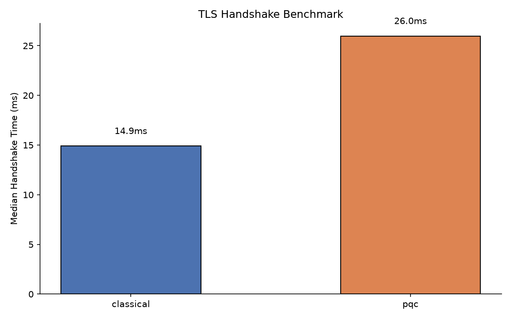
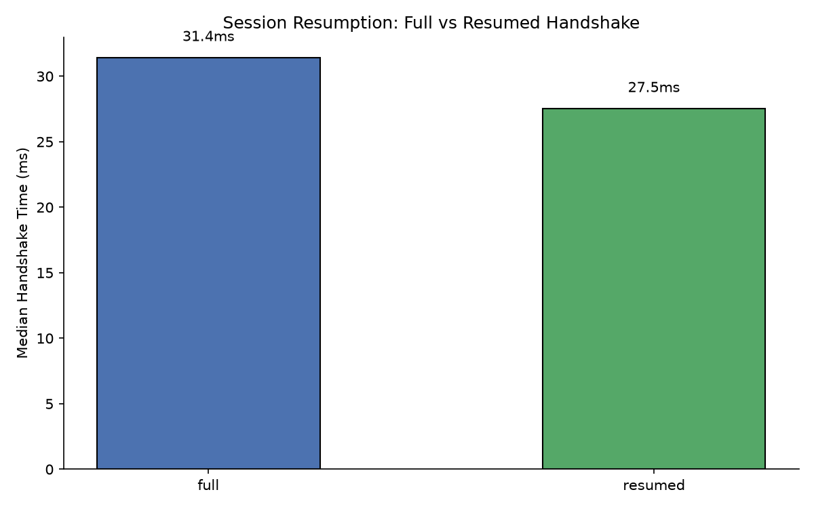
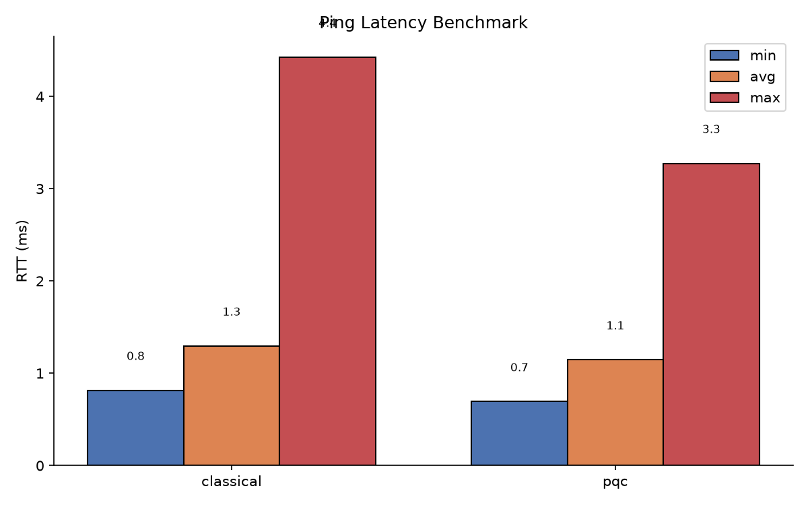
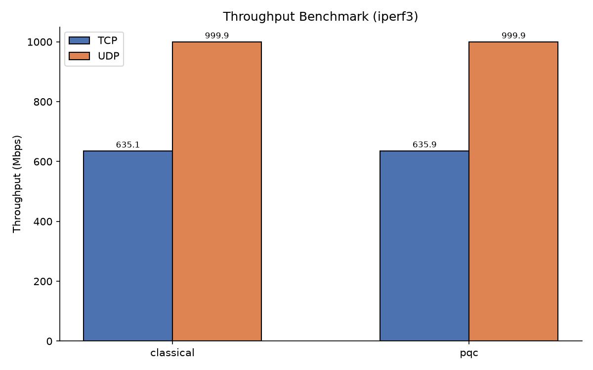
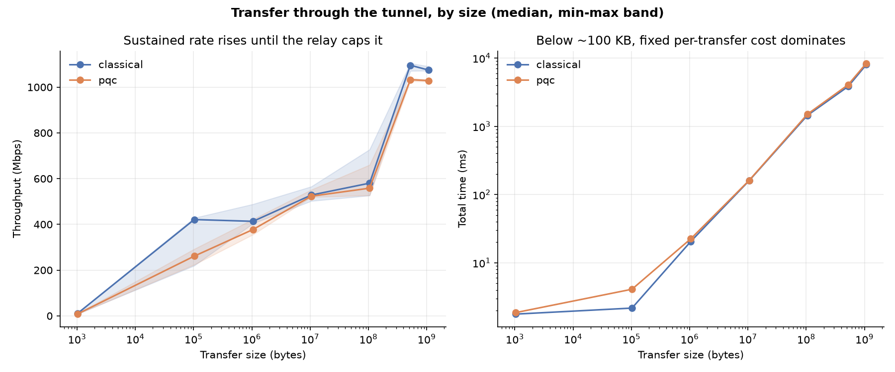
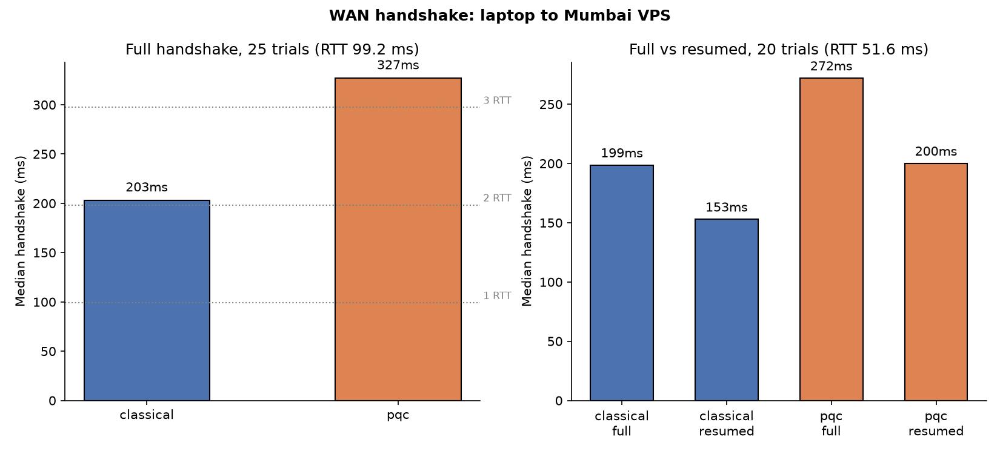
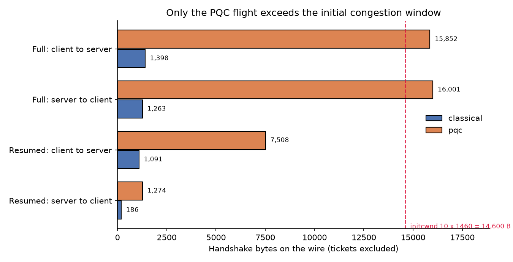
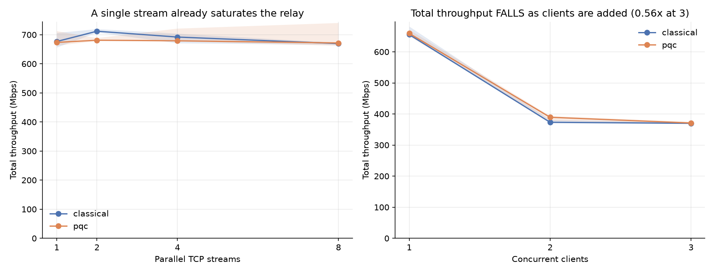

# PQ-VPN Benchmark Report

Canonical, compiled benchmark report. Raw per-trial data lives in
`benchmark/results/*.csv`; plots in `benchmark/results/plots/`. Generated with
`benchmark/run_handshake_bench.py` (handshake, resumption),
`benchmark/run_wan_handshake_bench.py` (real WAN, §7) and the netns shell
benchmarks `benchmark/run_{latency,throughput,file_transfer,scaling}_bench.sh`.

Every sweep ends by checking its own output (`benchmark/validate_results.py`,
step 5/5) and exits non-zero if a file is incomplete, unverified, or internally
inconsistent. The run published here passes with 0 failures and 0 warnings.

**Every table here is reproducible from the committed CSVs** — the raw per-trial
data is tracked, not just these summaries. To check any figure:

```bash
# median of a handshake table (§1, §7)
python3 -c "import csv,statistics as s;r=[float(x['ms']) for x in csv.DictReader(open('benchmark/results/handshake_classical.csv'))];print(round(s.median(r),2),len(r))"

# full vs resumed (§2, §7) — group by the 'kind' column
python3 -c "import csv,statistics as s;g={};[g.setdefault(x['kind'],[]).append(float(x['ms'])) for x in csv.DictReader(open('benchmark/results/handshake_resume_pqc.csv'))];print({k:round(s.median(v),2) for k,v in g.items()})"
```

## Environment

Every figure in §1 and §3–§5 and §8 comes from **one run on 2026-11-04,
15:45–16:02** (`sudo bash scripts/run_all_benchmarks.sh`, ~17 minutes), so
tables may be compared with each other without worrying about which day they
were taken. **§2 was re-measured at 17:20 the same day** — see the correction
note in that section. §7 (real WAN) still dates from 2026-09-23: it needs the
deployed VPS.

**Every data point is now repeated.** Latency, throughput and each scaling point
are measured 3 times, the transfer sweep 3 times per size, the handshake 5 x 25
and resumption 3 x 20. Tables report the median and state the spread. Single
samples were this suite's weakest point and produced at least two published
figures that later failed to reproduce.

- Ubuntu 24.04, Python 3.12, TUN MTU 1400. Kernel: 7.0.0-42-generic for the
  2026-11-04 run; 7.0.0-31-generic for the 2026-09-23 WAN figures.
- Classical: system OpenSSL 3.0.13. PQC: custom stack at `/opt/openssl-pqc` —
  **as measured**: OpenSSL 3.4.7-dev, liboqs 0.16.0, oqs-provider 0.12.0-dev.
- TLS 1.3, mutual auth. Classical: ECDSA P-256 + X25519.
  PQC: ML-DSA-65 + X25519MLKEM768 hybrid
- Loopback for handshake measurements; veth-pair netns harness for
  latency / throughput / file transfer
- Machine: an interactive desktop (browsers open), not a quiet benchmark host.
  The Python relay and the OpenSSL subprocesses compete for the same cores.

> **Version note.** `scripts/install_custom_openssl.sh` pins OpenSSL 3.4.7,
> liboqs 0.15.0 and oqs-provider 0.11.0 so clean builds (and CI) are
> reproducible. Those pins were added *after* the stack on this measurement
> machine was built, so the numbers below come from the slightly newer
> versions listed above. Re-measuring on the pinned set is pending; the
> relative classical↔PQC comparison is not expected to move, since both modes
> traverse identical code paths.

## Measurement variance

Absolute handshake times on this host depend strongly on desktop load. Seven
independent 20-trial measurements of the *same* PQC full handshake, taken within
two hours of each other on 2026-11-04, gave medians of **26.69, 32.25, 29.71,
32.11, 29.66, 32.04 and 27.66 ms** — a 1.21x spread with nothing changed between
them. Classical over the same period sat at 17.1–18.2 ms.

**The ratio between modes is far more stable than either absolute value**, so §1
and §2 report pooled medians across repetitions and state the spread. Single-run
figures from this machine should not be quoted to two decimal places as if
repeatable, and a difference smaller than about 20% between two handshake
medians is not a result.

This spread is also why §1 and §2 are cross-checked against each other: both time
the same full handshake, so a gap between them that exceeds the spread above
means one of the two did not measure what it claims. `validate_results.py`
enforces that, and it is how the discarded figure in §2 was found.

## 1. TLS Handshake (full, no resume)

**Method:** `openssl s_server -quiet` ready → `openssl s_client -quiet` connects,
negotiates, exits; timed `time.perf_counter()` → process wait. **5 independent
repetitions of 25 trials per mode (n = 125)**; the table pools all trials.

| Mode | Median (ms) | Min (ms) | Max (ms) |
|------|-------------|----------|----------|
| Classical (P-256 + X25519) | 18.95 | 12.52 | 22.14 |
| PQC (ML-DSA-65 + X25519MLKEM768) | 29.24 | 18.38 | 35.90 |

> **Measured 2026-11-04.** The previous run of this same benchmark gave 16.84 /
> 30.08 ms (ratio 1.79x) and the 2026-09-23 run 15.80 / 27.98 ms (1.77x).
> Classical moved +12.5%, PQC −2.8%, and **the ratio fell from 1.79x to 1.54x**
> without anything changing in the code. That movement is the variance note
> above, not a finding: all three runs are consistent with "PQC costs roughly
> 1.5–1.8x on loopback". An independent 25-trial check of the PQC figure taken
> two hours later gave 31.94 ms, which brackets the 29.24 recorded here.
>
> The repetition medians are not recoverable from the committed CSV: the five
> repetitions are pooled into one file without a repetition column, so only the
> pooled min–max is reproducible from the published data.

**PQC ≈ 1.5x slower median**, which should be read as "about one and a half
times", not to two decimal places. Cause: ML-DSA-65 certs 5577 B DER vs 386 B
for ECDSA P-256, plus the larger X25519MLKEM768 key share. One-time cost per
connection — and §7 shows it takes a different and larger form over a real WAN.



## 2. TLS Session Resumption (full vs resumed)

**Method:** one long-lived `s_server`; a priming connection writes a TLS 1.3
session ticket; then 20 interleaved full + `-sess_in` resumed handshakes.
**3 repetitions per mode (n = 60 per kind)**; the table pools all trials.
Resumption verified to skip the KEM + certificate exchange (`Reused, TLSv1.3`,
`pre_shared_key` ext).

| Mode | Full median (ms) | Resumed median (ms) | Speedup |
|------|------------------|---------------------|---------|
| Classical | 17.62 | 14.59 | 1.21x |
| PQC | 29.75 | 25.48 | 1.17x |

> **A figure was measured, checked, and discarded here.** The 15:45 sweep
> recorded a PQC full-handshake median of **16.96 ms** in this section while
> §1 — the same handshake, the same function, minutes earlier — recorded
> 29.24 ms. Classical agreed between the two sections (18.29 vs 18.95), so the
> discrepancy was PQC-specific and 1.72x wide.
>
> It was treated as a measurement to reproduce rather than a result to explain.
> Seven independent re-measurements gave 26.69, 32.25, 29.71, 32.11, 29.66,
> 32.04 and 27.66 ms. **None came close to 16.96**, and §1's 29.24 sits in the
> middle of them, so the sweep's §2 figures were discarded and this section was
> re-measured at full published scale (3 x 20 trials per mode, 17:20 the same
> day). The cause of the original 16.96 ms reading was never established; what
> is established is that it does not reproduce.
>
> `validate_results.py` now fails any run whose §1 and §2 full-handshake medians
> differ by more than 1.4x, so this cannot pass silently again.

**§1 and §2 are separate runs; compare within a table, not across.** Both
sections now agree on the full handshake to within 7% (classical 18.95 vs 17.62,
PQC 29.24 vs 29.75), which is what makes either of them quotable.

Modest on loopback because the KEM is a small share of the cost there. The real
win is the saved round-trip (one WAN RTT) plus skipped CPU for KEM/cert verify
over the internet, where latency dominates. The daemons cache the ticket per
server (`~/.pqvpn/cache/`) and resume automatically on reconnect.



## 3. Ping Latency (through tunnel, netns harness)

**Method:** `ping -c 100 -i 0.2 10.8.0.1` from the client namespace, both
modes, **3 repetitions**; the table reports the median of the three.

| Mode | Min (ms) | Avg (ms) | Max (ms) | Mdev (ms) |
|------|----------|----------|----------|-----------|
| Classical | 0.781 | 1.288 | 3.536 | 0.458 |
| PQC | 0.710 | 1.354 | 3.949 | 0.543 |

**The two modes are indistinguishable.** PQC is 0.07 ms *slower* on the average
here; the previous run of this benchmark had it 0.15 ms *faster*. A difference
that changes sign between runs is noise, which is the whole reason this
measurement is now repeated. Steady-state latency through the tunnel is ~1.3 ms
in both modes, and the floor is ~0.7–0.8 ms.

The 2026-08-26 run reported 2.29 / 2.33 ms average with a 117–119 ms maximum;
that maximum was the first ping against a cold tunnel and it dragged the average
up. A discarded warm-up now runs before each mode's measurements for exactly
that reason.

These are **idle-tunnel** figures, which is the easy case. §8.2 measures the
same ping while the tunnel is saturated.



## 4. Throughput (netns harness, iperf3, 10s)

**Method:** `iperf3 -c 10.8.0.1` from client namespace to server namespace,
**3 repetitions of 10 s each**; the table reports the median with the min–max
range. Bottleneck is the Python relay loop (veth + read/write), not crypto —
OpenSSL runs in a separate subprocess.

Three measurements, because one number cannot answer the question:

| Mode | Measurement | Delivered (Mbps) | Loss |
|------|-------------|------------------|------|
| Classical | TCP, 1 stream | 669.11 (636.84–677.85) | — |
| Classical | UDP, 1 Gbps offered | 957.06 (950.00–969.96) | 4.28% |
| Classical | UDP, line rate (`-b 0`) | 1396.49 (1348.34–1462.93) | 59.91% |
| PQC | TCP, 1 stream | 686.85 (649.74–731.32) | — |
| PQC | UDP, 1 Gbps offered | 972.41 (963.40–994.63) | 2.74% |
| PQC | UDP, line rate (`-b 0`) | 1317.92 (1309.43–1343.87) | 61.92% |

> **The previously published UDP figure was wrong, and the error was systematic
> rather than statistical.** Earlier revisions reported "999.90 Mbps, 0%
> penalty" for both modes. That was `end.sum` from the iperf3 JSON — the rate
> the client *transmitted*. The rate that *arrived* is `end.sum_received`, and
> at 1 Gbps offered it is 957–972 Mbps, because 3–4% of the datagrams were
> dropped. A UDP throughput figure quoted without its loss percentage is not
> interpretable, so every UDP row now carries one.

**The two modes agree to within 3%** on TCP and 2% on delivered UDP — the data
plane is not affected by the choice of key exchange. (The 2026-08-26 run
reported 1268 vs 533 Mbps and had to be described as "run variance"; that was
scheduling noise from a single unrepeated sample.)

**`-b 0` is the only one of the three that is a ceiling.** Offering 1 Gbps
answers "if we ask for 1 Gbps, does it arrive?" — mostly, yes. Offering line
rate finds the actual limit: ~1.4 Gbps delivered, with ~60% of what was offered
discarded. The loss is expected and structural: the tunnel's outlet is a single
TCP/TLS stream, so UDP flooded into the TUN queues up and is dropped rather than
delivered. **This measurement is destructive** — it leaves the relay draining a
full queue — so it is run last in each mode, after everything else is measured.

Delivered UDP (~1.4 Gbps) exceeds single-stream TCP (~670 Mbps) by about 2x.
That is consistent with TCP paying for acknowledgement traffic and congestion
control through the same single-threaded relay, but this project has not
measured that, so it is a candidate explanation and not a finding.



## 5. File Transfer across sizes (netns harness)

**Method:** `benchmark/transfer_bench.py`. The server generates a deterministic
byte stream on the fly; the client hashes it in flight and discards it. **Nothing
is written to disk at either end**, and both ends compute SHA-256 over the same
stream and compare. **Seven sizes spanning six orders of magnitude, 3
repetitions each per mode (42 transfers per mode)**; the table reports the
median with the min–max range.

> **This replaces the earlier measurement, and the change is a correction, not
> a refresh.** The 2026-08-26 version downloaded a real 100 MB file to disk with
> `http.server`. At the rates measured here a disk write can be slower than the
> tunnel, so **the old 0.68 s / 1.31 s figures were partly a filesystem
> benchmark** and the ~2x gap between modes was never attributable to crypto.
> Streaming also removes the free-space limit, which is why a 1 GB point is now
> possible on a disk with 1.5 GB free.

| Size | Classical (Mbps) | PQC (Mbps) | PQC / classical |
|------|------------------|------------|-----------------|
| 1 KB | 11.0 (8.3–13.2) | 8.5 (7.6–9.8) | 0.77x |
| 100 KB | 421.1 (219.3–428.2) | 261.0 (223.6–292.1) | 0.62x |
| 1 MB | 413.3 (404.0–488.4) | 377.7 (355.6–422.4) | 0.91x |
| 10 MB | 528.2 (502.2–565.4) | 523.2 (519.2–551.3) | 0.99x |
| 100 MB | 580.2 (526.0–727.4) | 558.3 (527.0–660.2) | 0.96x |
| 500 MB | 1095.7 (1070.9–1103.9) | 1032.7 (1026.3–1038.3) | 0.94x |
| 1 GB | 1074.8 (1071.9–1091.0) | 1028.6 (1024.4–1032.9) | 0.96x |

**21 / 21 transfers per mode verified SHA-256 correct, including both 1 GB
runs** (7 sizes x 3 repetitions). Throughput rises with size until it flattens
at ~1.03–1.10 Gbps from 500 MB on, reached once the transfer is long enough to
amortise setup. Both modes agree to within 6% from 1 MB up, and to within 4% at
500 MB and 1 GB.

**A prediction that was written down before measuring, and did not survive.**
The plan predicted that small transfers would be *setup*-dominated and would
therefore make PQC look worse, with the modes converging at large sizes. The
convergence happened (0.96–0.99x from 1 MB up). The small-size penalty did not,
and the reason is structural rather than statistical: the per-transfer setup
here is a plain TCP connect *inside an already-established tunnel*
(`socket.create_connection`, median 0.81 ms classical / 0.71 ms PQC across all
21 rows). **The TLS handshake is not in this measurement loop at all** — it is
paid once, when the tunnel comes up, and §1 is where it shows. So no
PQC-specific small-transfer penalty was ever possible here.

**The 1 KB and 100 KB rows should not be read as results in either direction.**
Both are too short to measure a rate: at 100 KB the whole transfer takes 2–4 ms,
so a single scheduling delay moves the figure by a factor of two. The evidence
that these columns are jitter rather than signal is that they do not hold still
and do not agree with each other — the previous run put PQC *ahead* at 1 KB
(1.41x) and behind at 100 KB (0.84x); this run reverses the first (0.77x) and
widens the second (0.62x); and classical's own three repetitions at 100 KB span
219–428 Mbps, a 1.95x spread against itself. The two modes' ranges overlap at
both sizes. Whatever these columns measure, it is not cryptography — the modes
share the data plane and the cipher, and the handshake is not in the loop.



## 6. Internet egress through the tunnel (netns harness)

**Method:** `scripts/demo.sh --mode pqc --clients 2 --egress`. The host NATs the
server namespace out its own uplink, so a client namespace can reach the public
internet *through* the tunnel. Each client fetches a public IP-echo service and
the result is compared with the host's own public address.

| Check | Result |
|-------|--------|
| Public IP seen by client 1 / client 2 | identical to the host's — traffic left via the tunnel + server NAT |
| `curl https://ifconfig.me/ip` from `vpn_ns2` | succeeds (DNS + TLS to a real site, inside the tunnel) |
| Client route table | `0.0.0.0/1` and `128.0.0.0/1` via `tun0`, above the namespace's metric-0 default |

Two settings are required for this to work and are on by default: **TCP MSS
clamping** on the server's forward path (the 1400-byte tunnel against a
1500-byte uplink otherwise blackholes path-MTU discovery) and the client's
**IPv6 default blackhole** (the tunnel is IPv4-only, so v6-capable sites would
otherwise be reached outside it).

The first run of this test found a real leak: the client used to install
`default … metric 50`, which loses to a metric-0 default route, so tunnel pings
worked while internet traffic silently bypassed the tunnel. The `/1` half-routes
fix it regardless of the host's metric.

## 7. Real-WAN handshake (laptop → AWS Lightsail, Mumbai)

**Method:** `benchmark/run_wan_handshake_bench.py ubuntu@<vps>` starts a plain
`openssl s_server` on the VPS over SSH and times `s_client` handshakes from the
laptop against it — TLS only, the VPN daemon is not involved, so these are
directly comparable in method to §1. Home Wi-Fi in India to `ap-south-1`.
Recorded 2026-09-23.

**Full handshake, 25 trials/mode** (TCP round-trip measured at 99.2 ms during
this run):

| Mode | Median (ms) | Min (ms) | Max (ms) |
|------|-------------|----------|----------|
| Classical | 203.0 | 90.8 | 304.4 |
| PQC | 327.0 | 202.4 | 668.2 |



**PQC = 1.61x, i.e. +124 ms.** Classical's 203 ms is almost exactly two round
trips (TCP connect + TLS 1.3), as expected. PQC lands near 3.3 round trips.

**This is the opposite of what loopback suggests.** On loopback PQC costs
+10 ms (§1: 29.24 vs 18.95) — pure CPU for the bigger certificate and key
share. Over a WAN the cost
is ~124 ms, about one extra round trip. `benchmark/measure_handshake_bytes.py`
measures where the bytes go: the PQC server's handshake flight is **16 001 B**
against a **14 600 B** initial congestion window (and the client's, under mutual
TLS, is 15 852 B), so it cannot be sent in one burst. A HelloRetryRequest — the
other way to buy exactly one round trip — was checked for and does not occur.



The measured round-trip counts are consistent with the larger handshake flight
costing an extra round trip; **this is inferred, not confirmed by packet
capture.** See `docs/PROJECT_REPORT.md` §13 for the full message-size table and
the other candidate explanations.

**Full vs resumed, 20 trials/mode** (interleaved against one long-lived server;
round-trip measured at 51.6 ms during this later run — the path was quieter, so
compare within this table only):

| Mode | Full median (ms) | Resumed median (ms) | Saved | Speedup |
|------|------------------|---------------------|-------|---------|
| Classical | 198.6 | 152.9 | 45.7 ms | 1.30x |
| PQC | 272.0 | 200.0 | 72.0 ms | 1.36x |

Resumption saves **more** for PQC in absolute terms (72 ms vs 46 ms), and on
loopback the same effect is modest (§2: PQC 1.17x), so it matters far more over
the internet than lab figures suggested.

It does **not** remove most of the penalty, though. The PQC handshake is still
47 ms (~0.9 round trips) slower than classical even when resumed, and only
about 26 ms of the 73 ms full-handshake gap disappears.
`measure_handshake_bytes.py` shows why: a resumed PQC ClientHello is **7456
bytes against 1039 classical**, because the PSK identity *is* a 5833-byte
ticket and the server returns another one. Resumption drops the certificates
but not the bulk. It is the most effective optimisation available here, not a
fix.

## 8. Scaling and behaviour under load (netns harness)

**Method:** `benchmark/run_scaling_bench.sh <mode>`, run from the host so it can
drive several client namespaces at once. 10 s per data point. Three questions
the rest of the suite does not answer.

### 8.1 Is the throughput ceiling per-stream, or the relay?

`iperf3 -P 1,2,4,8` from one client.

`iperf3 -P 1,2,4,8` from one client, **3 repetitions per point**; median with
min–max.

| Parallel streams | Classical (Mbps) | PQC (Mbps) |
|------------------|------------------|------------|
| 1 | 676.68 (656.68–706.68) | 673.59 (663.36–712.94) |
| 2 | 712.09 (707.98–720.06) | 681.15 (678.79–689.20) |
| 4 | 692.02 (671.16–704.29) | 679.12 (677.90–721.75) |
| 8 | 669.61 (665.77–672.91) | 671.76 (662.33–741.06) |

**It is the relay, and a single stream already saturates it.** All 24
measurements lie between 656 and 741 Mbps. Adding streams does not raise the
total, which is what a per-stream ceiling would do; it does not lower it either.
The project's stated limitation — that throughput is bounded by the Python
`select` relay rather than by OpenSSL — was asserted in earlier revisions of
this document and is now measured.

> **This replaces a published figure, and the correction strengthens the
> result.** The previous revision reported 759 → 1010 Mbps across 1 → 8 streams
> and concluded "two streams saturate the relay". Those were **four single
> 10-second samples with no repetitions**. Repeating each point three times
> gives a flat series, and the flat series is the one that is internally
> consistent: the old run reported 635 Mbps (§4, one stream), 715 Mbps (§8.3,
> one client) and 1010 Mbps (§8.1, eight streams) for what is substantially the
> same measurement, while this run reports 669, 655 and 670. The conclusion does
> not weaken — the ceiling is still the relay — but it arrives one stream
> earlier than previously claimed.

**One thing this does not explain.** A single iperf3 TCP stream reaches ~670
Mbps (§4) while a 1 GB bulk transfer through the same tunnel sustains ~1075
Mbps (§5), and eight parallel iperf3 streams do not close the gap. The earlier
revision explained this away as "a single-stream and a saturating measurement of
the same ceiling"; §8.1 rules that explanation out, because saturating with
eight streams still yields 670. The two tests do differ in direction — iperf3
sends client → server, `transfer_bench.py` streams server → client — but that
asymmetry has not been measured, so **the 1.6x gap is currently unexplained**.
Adding a reverse-direction `iperf3 -R` row would settle it. The gap is present
in the previous run too (635 vs 1081), so it is long-standing rather than new.

### 8.2 What happens to latency when the tunnel is saturated?

Ping from the same namespace as the load, so it queues behind the same traffic.

**3 repetitions per point**; median with min–max.

| Mode | Idle (ms) | Under load (ms) | Degradation |
|------|-----------|-----------------|-------------|
| Classical | 1.31 (1.25–1.34) | 30.85 (17.29–31.48) | 24x |
| PQC | 1.31 (1.22–1.39) | 20.75 (18.75–28.07) | 16x |

**Latency degrades by more than an order of magnitude under saturation.** This
is the honest counterpart to §3: an idle tunnel at ~1.3 ms says little about a
tunnel in use. The mechanism is queueing in the single-threaded relay — a ping
waits behind whatever bulk traffic is already buffered — and it is a real
usability limit, not a measurement artefact.

The classical/PQC gap in this table is **not** evidence of a crypto cost, and
the repetitions now demonstrate that rather than asserting it: the previous run
had classical at 17 ms and PQC at 31 ms, this run has classical at 31 ms and PQC
at 21 ms, and the ranges overlap (17.3–31.5 against 18.8–28.1). **The ordering
reverses between runs**, which is what noise looks like. Read this table as
"both degrade by roughly 15–25x under saturation", and read the per-mode
difference as unmeasured.

### 8.3 Does the server scale across clients?

Total throughput with 1, 2 and 3 clients transferring at once. Each client gets
its own `iperf3` server on its own port, so the load is genuinely concurrent
rather than three tests taking turns.

**3 repetitions per point.** Each client gets its own `iperf3` server on its
own dedicated port (5301–5303), each port is verified to be listening before the
round starts, and **every row records how many clients actually reported** —
`3of3:132+124+119` means three clients ran and these were their individual
rates.

| Concurrent clients | Classical (Mbps total) | PQC (Mbps total) |
|--------------------|------------------------|------------------|
| 1 | 655.39 (652.67–681.68) | 659.30 (650.54–671.29) |
| 2 | 373.30 (370.50–381.24) | 389.39 (377.98–393.93) |
| 3 | 369.98 (368.29–373.88) | 370.94 (369.54–375.33) |

**Total throughput falls as clients are added.** Three clients together move
**44% less data than one client alone** — the design does not merely fail to
scale, it degrades, and most of the loss happens on the step from one client to
two. The cause is the architecture this benchmark was written to test:
`server/vpn_server.py` demultiplexes every client's return traffic through **one
shared TUN reader** in a single `select` loop, so each additional client adds
contention to a resource that was already the bottleneck in §8.1.

**The clients do share fairly.** The per-client composition recorded in the CSV
shows 188+186, 185+185 and 192+189 at two clients, and 132+124+119, 129+122+119
and 123+125+120 at three: no client is starved, the total is simply smaller.

Both modes track each other to within 1% at three clients, which again isolates
this from the crypto: it is a relay-architecture result, and the fix is the
compiled, multi-queue relay listed under Future Work.

> **Why the per-client composition is recorded.** An earlier run of this
> benchmark reported 2 clients and 3 clients at 367.64 and 367.70 Mbps —
> suspiciously identical — and nothing in the data could distinguish "a real
> ceiling" from "one client silently failed to start and the total came from
> two". The multi-client section also shared port 5201 with the sections above
> it, and an `iperf3` server handles one test at a time, so a client could be
> refused as *server busy* while the others succeeded. Dedicated ports and a
> recorded client count remove both ambiguities; a round with a missing client
> is now written as `INCOMPLETE_2of3` with no value, and `validate_results.py`
> fails the run.



## Validation

`bash scripts/demo.sh --dry-run` runs five suites — **207 checks**:

| Suite | Checks | Covers |
|-------|--------|--------|
| `common/test_common.py` | 92 | framing, welcome→TLS config push, slot/port recycling, CRL revocation against a real `s_server`, rate limiter, IPC |
| `common/test_net_config.py` | 36 | NAT, MSS clamp, route protection/restore, IPv6 guard, DNS fallback |
| `common/test_keepalive.py` | 7 | keepalive, idle detection, backoff, session-stop cascade |
| `common/test_resumption.py` | 14 | ticket cache, wrapper flags, real OpenSSL prime→`Reused` |
| `dashboard/test_dashboard.py` | 58 | IPC envelope, endpoints, token auth, single poller, WS |

## Interpretation

| Metric | Classical → PQC | Verdict |
|--------|-----------------|---------|
| WAN full handshake | 1.61x (+124 ms) | About one extra round trip, not CPU — the real deployment cost |
| WAN resumed handshake | saves 72 ms (1.36x) | Helps far more than loopback showed, but PQC stays ~47 ms behind |
| Full handshake (loopback) | 1.54x slower (+10 ms) | Only PQC cost; once per connection/reconnect. Read as "about 1.5x" |
| Resumed handshake | 1.17x vs 1.21x | Resume helps both modes about equally on loopback |
| Ping latency (idle) | +0.07 ms | Indistinguishable; sign reverses between runs |
| TCP throughput | 1.03x (PQC faster) | No data-plane penalty; within run-to-run spread |
| UDP delivered, 1 Gbps offered | 1.02x | Both ~960–970 Mbps at 3–4% loss |
| UDP ceiling (`-b 0`) | 0.94x | Both ~1.3–1.4 Gbps delivered at ~60% loss |
| Transfer, 1 MB – 1 GB | 0.91–0.99x | Not crypto-bound |
| Transfer, 1 KB – 100 KB | 0.62–0.77x | **Not a result** — too short to measure a rate; see §5 |
| Parallel streams, clients | within 1% | Relay-bound in both modes |

Key takeaways:

1. **PQC is practical for VPNs.** The cost is confined to the one-time
   handshake — about 1.5x on loopback (CPU, +10 ms) and 1.61x over a real WAN,
   where it takes the form of about one extra round trip. What causes that round trip is
   not established (§7): the PQC flight does exceed the initial congestion
   window, which is consistent with it, but no packet capture confirms the
   link. TLS session resumption recovers part of the penalty (72 ms, 1.36x) and
   the daemons resume automatically.
2. **Steady-state data plane is identical** — both modes use AES-256-GCM; PQC
   only affects the initial key exchange.
3. **Throughput is bounded by the Python relay** (`select` + `read`/`write`),
   not by OpenSSL subprocesses — measured directly in §8.1: a single stream
   already saturates the ceiling at ~670 Mbps and two, four or eight add
   nothing. Removing it requires a compiled relay (Tier 3 — see Future Work).
4. **The relay architecture, not the cryptography, is this project's real
   limitation.** Latency degrades 16–24x under saturation (§8.2) and total
   throughput *falls* 44% between one client and three (§8.3). Both follow from the single
   shared TUN reader, both are mode-independent, and neither would have been
   visible from the idle-tunnel and single-client numbers the suite used to
   report. This is the most significant negative result in the project.
5. **Custom OpenSSL ≥ 3.2 is mandatory** for ML-DSA certs; system OpenSSL 3.0.x
   cannot load OID-based signature algorithms.

## Future Work (explicitly out of current scope)

- **Tier 3 performance:** Go/C rewrite of the relay, `splice()` batching,
  multi-queue — target >2 Gbps. (The `-b 0` UDP ceiling is now measured: §4.)
- **Explain the 1.6x iperf3-vs-bulk-transfer gap** (§8.1). One reverse-direction
  `iperf3 -R` row would establish whether the relay is directionally asymmetric
  or the difference lies in how the two tools write.
- **Production auth:** PAM / directory-backed accounts. (Per-client certificates
  with CRL revocation and welcome-port rate limiting are implemented; MTU
  auto-negotiation is not.)
- **Multi-client scaling.** §8.3 shows total throughput *falling* from 655 to
  370 Mbps between 1 and 3 clients, so the open item is no longer "measure it"
  but "fix it": the single shared TUN reader needs to become per-client queues
  or a multi-queue TUN before an IP pool beyond 3 clients is worth building.
  Per-client bandwidth QoS is also unimplemented.
- **Live WAN numbers:** handshake and resumption are measured (§7). Still open:
  WAN latency/throughput through the tunnel itself, and whether a smaller
  certificate chain (ML-DSA-44, or a hybrid with a compressed chain) removes
  the extra round trip.
- **Key rotation:** mid-stream rekey is unsupported (no s_server
  renegotiation); reconnect + resume is the workaround.

## Reproducing

Everything in §1–§5 and §8 regenerates with one command, which builds the netns
harness, runs both modes against a live tunnel, tears the harness down on every
exit path, regenerates the plots and hands the files back to your own user:

```bash
sudo bash scripts/run_all_benchmarks.sh            # full sweep, ~17 minutes
sudo bash scripts/run_all_benchmarks.sh --mode pqc # one mode only
sudo bash scripts/run_all_benchmarks.sh --quick    # smoke test, see note
```

The sweep ends with a validation step and prints **VALIDATION PASSED** or
**VALIDATION FAILED**, exiting non-zero on failure, so a bad run announces
itself instead of being discovered later in the CSVs. It checks that the
expected rows exist, that every transfer verified its SHA-256, that no
multi-client total came from fewer clients than it claims, that §1 and §2 agree
on the full handshake, and that the two modes agree at bulk transfer sizes —
they share the data plane and the cipher, so a large gap there is a disturbed
measurement, not a result. To check a directory by hand:

```bash
.venv/bin/python3 benchmark/validate_results.py --dir benchmark/results
```

Two environment variables exist for isolating measurement-order effects:
`PQVPN_MODE_ORDER=reverse` measures PQC first (if a mode difference changes sign,
it was ordering), and `PQVPN_TPUT_UDP_MAX=0` skips the destructive line-rate UDP
flood.

> `--quick` writes to a **temporary directory**, not `benchmark/results/`, and
> prints the path. It runs a fifth of the handshake trials and three of the
> seven transfer sizes, so pointing it at the published CSVs would silently
> replace good data with worse data — which is exactly what happened once, and
> cost a full sweep.

The individual benchmarks, if you want to run one on its own:

```bash
cd /home/chacko/Chacko/VPN

# Handshake: 25 trials/mode
.venv/bin/python3 benchmark/run_handshake_bench.py --modes classical pqc --trials 25

# Resumption: full vs resumed, 20 trials/mode
.venv/bin/python3 benchmark/run_handshake_bench.py --modes classical pqc --resume --trials 20

# Netns benchmarks (require the tunnel up + sudo):
#   server ns:  sudo ip netns exec vpn_ns1 iperf3 -s
#   client ns:  sudo ip netns exec vpn_ns2 bash benchmark/run_latency_bench.sh <mode>
#               sudo ip netns exec vpn_ns2 bash benchmark/run_throughput_bench.sh <mode>
#               sudo ip netns exec vpn_ns2 bash benchmark/run_file_transfer_bench.sh <mode>
#   host:       sudo bash benchmark/run_scaling_bench.sh <mode>
#
# Transfer sizes and repetitions are overridable:
#   PQVPN_BENCH_SIZES="1K 1M 100M" PQVPN_BENCH_REPS=3 ...

# Regenerate all plots (--dir to read and write somewhere else):
.venv/bin/python3 benchmark/plot_results.py
```
