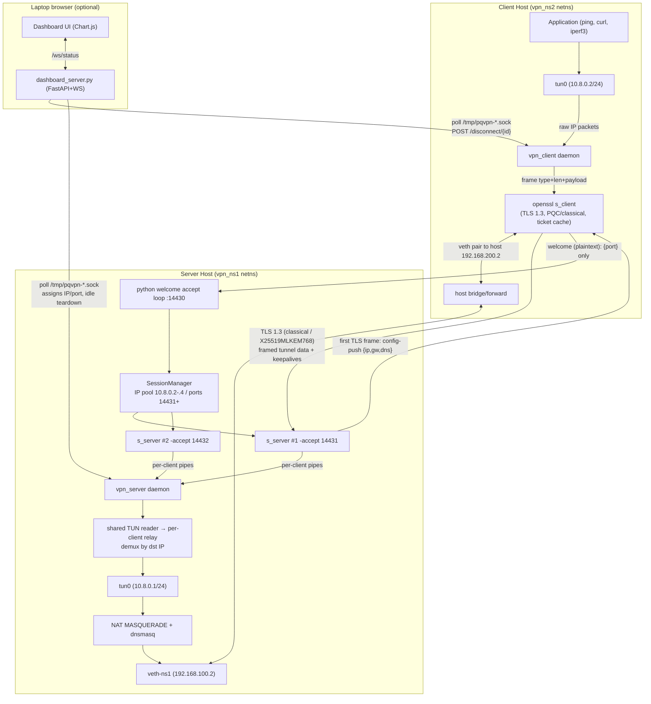

# PQ-VPN Architecture

## Overview

PQ-VPN is a Linux TUN-based Layer-3 VPN tunnel that encrypts IP packets inside TLS 1.3 streams with dual-mode crypto support (classical ECDSA and post-quantum ML-DSA-65/ML-KEM-768).

The design decision to use `openssl s_server/s_client` subprocesses instead of Python's `ssl` module solves a fundamental limitation: Python's `ssl3_set_cert` hardcodes `EVP_PKEY` type IDs, making it unable to load OID-based signature algorithms like ML-DSA-65. OpenSSL >= 3.2 dispatches certificate signature verification to the provider interface, enabling pure PQC certificates.



The client opens the welcome channel first (thin plaintext TCP) and receives
**only** a dedicated data port. It then opens the real mTLS data connection to
that port; the server has already written the full config-push (tunnel IP,
gateway, DNS, subnet) into that `s_server`'s stdin, so it is delivered as the
first application-data frame **after** mutual certificate verification. Nothing
a MITM on the welcome channel could alter is ever applied to the client's
routing or DNS. The server runs one `openssl s_server -naccept 1` per client
and a shared TUN reader demuxes inbound tunnel packets to the right client by
destination IP (dict lookup on the packed address).

**Slots and ports.** The IP pool is capped at `max_clients` addresses and each
address is a fixed slot: slot *n* always listens on `data_port_base + n`
(default 14431–14433). Client ids keep counting up for logs and the dashboard,
but a reconnecting client is reassigned inside that range, so the firewall
rule never has to change. A slot is released only after its `s_server` has
actually exited (`SessionManager.remove` drains the process first), and
`-naccept 1` makes that happen the moment the client hangs up instead of at
the 45 s idle timer. A slot claimed via the welcome port that never completes
mTLS is reaped after `handshake_timeout` (10 s) — the bound on what an
unauthenticated welcome connection can cost.

## Data Plane

The tunnel carries raw IP packets (no Ethernet headers) through the TUN device. Every byte on the wire is wrapped in a typed frame (control vs data) so keepalives, config-push, and tunnel packets share one stream:

```
┌─────────┬────────────┬──────────────────┐
│ 1 byte  │ 4-byte BE  │      payload     │
│  type   │  length    │ (data or control)│
└─────────┴────────────┴──────────────────┘
```

The framing protocol (`common/framing.py`):

```python
TYPE_DATA = 0x00; TYPE_CONTROL = 0x01
HEADER_LEN = 1 + 4   # [type:1][length:4][payload]
pack_frame(data, ftype=TYPE_DATA)      # prepend type+length header
unpack_frames(buffer)                  # yields (ftype, payload)
pack_config(config)                    # JSON config-push control frame
pack_keepalive() / is_keepalive()      # 'KA' control frame
unpack_config(buffer)                  # config-push from stream head
```

Packets are relayed by two daemon threads:
1. **TUN → TLS**: `select()` + `os.read(tun_fd)` → pack → `os.write(tls_stdFd)`
2. **TLS → TUN**: accumulate TCP stream bytes in buffer → unpack → `os.write(tun_fd)`

Both use 500ms polling intervals and exit on `BrokenPipeError` or EOF. On the client the TLS→TUN thread is the one that reliably sees the TLS side die (EOF on `s_client` stdout); its exit sets a per-session stop event that the TUN→TLS thread and the keepalive loop also watch, so a server-side teardown (idle reap, dashboard kick, crash) unwinds the whole session within ~0.5s even when the tunnel is idle — previously the TUN reader only noticed on its next write, which on an idle tunnel could be never. Idle sessions are torn down by a keepalive-based idle monitor, and the client reconnects with exponential backoff (1→30s).

## TLS Configuration

### www.openssl.cnf (via OpenSSL flags)

**Classical mode** (default OpenSSL, no provider flags):
```
openssl s_server -accept 0.0.0.0:14430 -cert server.crt -key server.key -CAfile ca.crt -Verify 1 -quiet
```

**PQC mode** (custom OpenSSL 3.4.7):
```
/opt/openssl-pqc/bin/openssl s_server \
  -provider oqsprovider -provider default \
  -groups X25519MLKEM768 \
  -accept 0.0.0.0:14430 -cert server.crt -key server.key -CAfile ca.crt -Verify 1 -quiet
```

Environment setup (`common/openssl_wrapper.py:`:

```python
def _make_env(mode, config_dir):
    if mode == 'pqc':
        env['PATH'] = '/opt/openssl-pqc/bin:' + env['PATH']
        env['LD_LIBRARY_PATH'] = '/opt/openssl-pqc/lib64:/opt/openssl-pqc/lib:' + env.get('LD_LIBRARY_PATH', '')
        env.pop('LD_PRELOAD', None)
        env['OPENSSL_CONF'] = 'pki/openssl-pqc-runtime.cnf'  # SECLEVEL=0 only
    return env
```

## Certificate Chains

Both PKI trees use a 3-certificate chain (CA → server, CA → client). All certs are generated with 10-year expiry (3650 days).

### Classic PKI (`pki/certs/classical/`)

| Component | Algorithm | Key Size |
|-----------|-----------|----------|
| CA certificate | ECDSA P-256 Self-signed | ~128-bit security |
| Server cert | ECDSA P-256 Signed by CA | ~128-bit |
| Client cert | ECDSA P-256 Signed by CA | ~128-bit |
| TLS group | X25519 (default) | ~128-bit |

### PQC PKI (`pki/certs/pqc/`)

| Component | OpenSSL Version | Algorithm | Security Level |
|-----------|----------------|-----------|----------------|
| CA cert | Custom 3.4.7 | ML-DSA-65 (dilithium3) | NIST Level 3 |
| Server cert | Custom 3.4.7 | ML-DSA-65 | NIST Level 3 |
| Client cert | Custom 3.4.7 | ML-DSA-65 | NIST Level 3 |
| TLS handshake | Custom 3.4.7 | X25519MLKEM768 | NIST Level 3 |

Cert algorithms verified empirically (`openssl x509 -text`): CA, server, and
client certs are all `mldsa65` (OID 2.16.840.1.101.3.4.3.18), and the TLS 1.3
CertificateVerify therefore also uses `mldsa65` — the scheme must match the
cert key type, so the live `Signature type: mldsa65` in s_client brief output
is genuine post-quantum authentication, not a negotiation artifact.

## Network Namespace Test Harness

Testing entirely within a single Linux machine:

```
                    ┌──────────────────┐
                    │   Host (default)  │
                    │                    │
              ┌─────── veth-h (10.0)  │◄──── veth-h2 (192.168.200.2)────┐
              │     │  veth-p1 (direct) │                        │     │
              │     └─────────────────┘                        │     │
              │                                                │     │
      ┌───────▼──────┐                                           ┌───────▼──────┐
      │  vpn_ns1      │    veth peer 10.0.10.0/24             │  vpn_ns2      │
      │ (server)     │◄──────────────────────────────────────►│ (client)     │
      │ 192.168.100.2 │     veth-p1 <-> veth-p2                │ 192.168.200.2 │
      │ tun0: 10.8.0.1 │                                           │ tun0: 10.8.0.2 │
      │ NAT+FORWARD  │                                           │ no nat       │
      └──────────────┘                                           └──────────────┘
```

Three veth pairs:
1. **host↔ns1**: Host forward to 192.168.100.0/24 (server's network)
2. **host↔ns2**: Host forward to 192.168.200.0/24 (client's network)
3. **ns1□ns2**: Direct peer crossing 192.168.10.0/24 for direct icless ping

Forwarding rules:
- All veth interfaces have `rp_filter=0`
- `ip_v4_forward=1` on host
- Host bridge `iptables` allow all forward between veth-h and veth-h2
- vpn_ns1 has MASQUERADE NET for TUN subnet 10.8.0.0/24

## IPC Layer

Daemons expose a Unix domain socket (`/tmp/pqvpn-server.sock`, `/tmp/pqvpn-client.sock`) for IPC with the CLI and dashboard:

```python
# common/daemon_utils.py
class StatusTracker:   # thread-safe state tracking (bytes, uptime, crypto mode, group, resumed)
class IpcServer:       # Unix domain socket server on daemon thread
class Writer:          # PID/socket file operations
```

Two request shapes:

- **Bare request** (vpnctl): `connect → send JSON query → recv JSON response` returning the status snapshot.
- **Command request**: `{'command': 'disconnect', 'id': ...}` → the daemon's `command_handler` runs it and replies with `{'status': {...}, 'result': {...}}`. Implemented commands: `disconnect` (force session teardown), `clients` (list tunnels), `status`.

The server uses a 100ms `select()` wait so bare status polls never block on a full 2s recv timeout.

The sockets are created `0666` so a non-root `vpnctl`/dashboard can talk to root-owned daemons. That means **any local user** can read status and issue `disconnect`/`shutdown` — acceptable for a single-user host, since the same user could already stop the process; on a shared machine move the sockets under a group-restricted directory.

### Dashboard

`dashboard/dashboard_server.py` runs **one** background poller (`StatusFeed`) that refreshes a cached snapshot every 0.5s; every WebSocket client and `GET /api/status` reads that cache, so open tabs do not multiply IPC load. Mutating endpoints (`POST /disconnect/{id}`, `POST /rekey`) require the dashboard token in an `X-PQVPN-Token` header: the custom header forces a CORS preflight, which blocks cross-origin pages from driving the dashboard (CSRF), and the secret guards a LAN-exposed instance. The token comes from `--token`, `$PQVPN_DASH_TOKEN`, or is generated and printed at startup; it is never served by any endpoint, so the operator pastes it into the page (kept in `localStorage`). The UI leads with the negotiated suite for the current session (protocol, key exchange, signature, cipher, with plain-language notes on which are quantum-safe), then aggregate throughput over the last 60 s (two series: clients→server and server→clients), a tunnels table with per-row sparklines, live rate, share of traffic and a Disconnect action, the client daemons on the machine, and an event timeline that records tunnel arrivals/departures and state changes.

## Security Considerations

| Concern | Mitigation |
|---------|------------|
| Memory exposure | OpenSSL subprocess isolation; child process can crash but data is confined to pipe buffer |
| Certs stored in plain | `pki/certs/` in `.gitignore`, never committed |
| PQC cert fingerprinting | `-groups X25519MLKEM768` hides ML-KEM from non-PQC peer |
| Compromised PKI | Both modes always require mutual TLS authentication: client and server both present certs |
| Compromised / lost client key | Per-client certificates from a real CA database (`pki/issue_client.sh`); `pki/revoke_client.sh <mode> <name> [--kick]` adds it to `crl.pem`, which every new `s_server` loads (`-CRL -crl_check -verify_return_error`) so the next handshake fails with alert 44, and `--kick` ends the live session via `vpnctl disconnect-client`. No daemon restart. |
| Network namespace-level censoring | `setup_routing.sh` creates isolated netns; no exposed interfaces except via defined rules |
| IPv6 leak (tunnel is IPv4-only) | Client blackholes its IPv6 default route while connected (`block_ipv6`, default on); restored on disconnect |
| PMTU blackholes through the 1400-byte tunnel | Server clamps TCP MSS to path MTU on the forward path in both directions (`mss_clamp`, default on) |

### Limitations

- No mid-stream key rotation (s_server has no renegotiation); rekey = reconnect (ticket resumption keeps it cheap)
- The welcome port is unauthenticated: anyone can claim a slot for up to
  `handshake_timeout` seconds and, in that window, race the legitimate client
  to its data port (a foreign TCP connect consumes the `-naccept 1` budget and
  the client falls back to a fresh welcome). Two bounds keep this cheap: the
  10 s reap, and a per-source token bucket on the welcome port
  (`welcome_rate` 1/s, `welcome_burst` 3 — `WelcomeLimiter`), applied before any
  slot or subprocess is touched, so a flooding source costs one `accept()` per
  attempt. A distributed flood from many sources is still Future Work; mTLS
  guarantees no tunnel is ever established with an unauthenticated peer.
- **Session resumption is connection-lifetime only**: each client session gets a
  fresh `s_server` process, which generates fresh TLS ticket-encryption keys.
  A cached ticket from a previous server lifetime therefore never resumes
  (the handshake silently falls back to full). Status reports `resumed` only
  on hard evidence (cert exchange skipped), so it reads `false` across
  restarts even with a populated ticket cache. This cannot be fixed with
  `openssl s_server`: it exposes no way to load a ticket key (only
  `-num_tickets`/`-no_ticket`; the key is random per process). The fix is a
  small custom TLS server linked against the same OpenSSL that installs
  `SSL_CTX_set_tlsext_ticket_key_evp_cb` with a key from a file — Future Work,
  and the same change would enable mid-stream rekey (KeyUpdate).
- **Revocation is file-based**: `crl.pem` is read when a session's `s_server`
  starts, so a revoke applies to every *new* connection (and `--kick` ends the
  current one). No CRL distribution points or OCSP; the CRL is shipped with the
  PKI (`deploy_vps.sh` re-syncs `pki/`). The client's announced name is used for
  display and targeted disconnects only — authorisation is the certificate + CRL.
- Python GIL-bound CPU limit, ~700 Mbps TCP/UDP throughput measured (IP limits, not crypto)
- NAT/dnsmasq/default-route plumbing is config-driven (`server/net_config.py`,
  `client/net_config.py`), validated via `--dry-run` unit tests and the live
  netns demo

## Session Resumption

The client caches the server's TLS 1.3 session ticket per server (`common/ticket_cache.py`, `~/.pqvpn/cache/<host>.<sha16>.tick`). On reconnect it passes the ticket via `-sess_in` and refreshes it with `-sess_out`, so the resumed handshake skips the KEM and certificate exchange (verified `Reused, TLSv1.3` for both classical and `X25519MLKEM768`). Measured over loopback: classical 15.0→13.5ms, PQC 24.4→23.7ms median handshake; the real saving is one WAN RTT. Toggle with `resume_cache` in the client config.