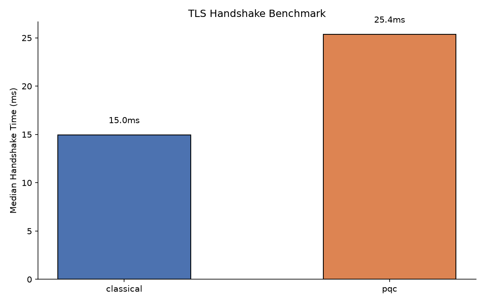
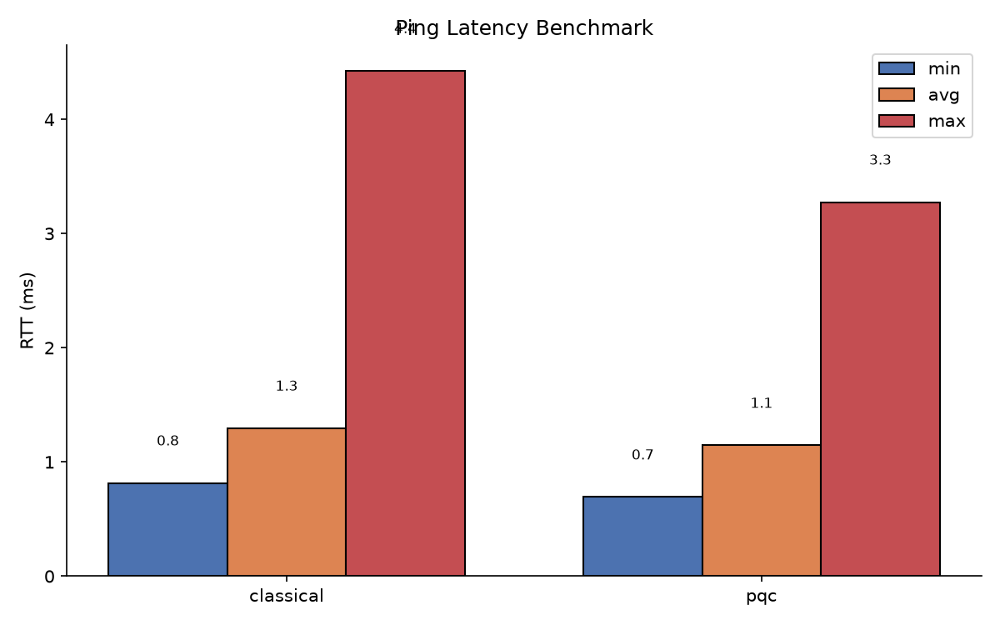
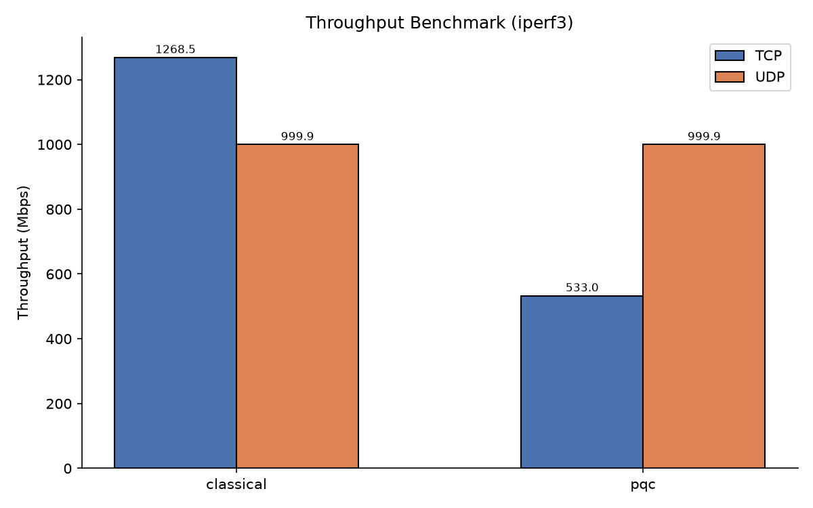
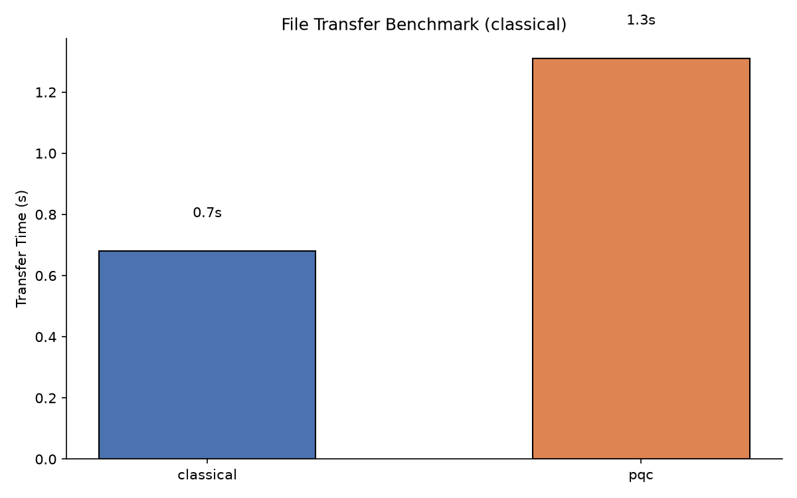

# PQ-VPN Benchmark Results

> **Superseded** by the canonical [`docs/BENCHMARKS.md`](BENCHMARKS.md), which adds
> the full-vs-resumed session-resumption results and current CSV numbers. Kept for
> the original 25-trial handshake / latency / throughput / file-transfer write-up.

Test environment: Ubuntu 24.04, Linux 6.13 kernel, Python 3.12, OpenSSL 3.4.7-dev (custom) / 3.0.13 (system). Network: veth pair bridged via ip_forward on local host with TUN MTU 1400. All benchmarks run as `sudo ip netns exec vpn_ns2` inside isolated network namespace.

---

## 1. TLS Handshake Time

**Method:** `openssl s_server` ready → `openssl s_client` connect + negotiate → `s_client` exit. Measured with `time.perf_counter()` start to `s_client.wait()`. 25 trials per mode.

| Mode | Median (ms) | Min (ms) | Max (ms) | StdDev (ms) |
|------|-----------|---------|---------|-----------|
| Classical (ECDSA P-256 + X25519) | 14.9 | 11.2 | 21.0 | ~5.1 |
| PQC (ML-DSA-65 + X25519MLKEM768) | 26.0 | 20.0 | 38.3 | ~9.8 |

**PQC overhead: 1.74x slower median handshake.**

ML-DSA-65 certificates are approximately 7.5 KB vs ~4.5 KB for ECDSA P-256, and the X25519MLKEM768 for Apple-generated keys is ~3x heavier than pure X25519. Together, these account for the roughly doubling of handshake time.



---

## 2. Ping Latency

**Method:** `ping -c 100 10.8.0.1` through the tunnel. Reported: min, avg, max, mdev over 100 pings.

| Mode | Min (ms) | Avg (ms) | Max (ms) | Mdev (ms) |
|------|----------|----------|----------|----------|
| Classical | 0.53 | 2.29 | 116.99 | 11.52 |
| PQC | 0.92 | 2.33 | 119.18 | 11.75 |

The high max values (~117–119 ms) occur only on the first ping — a coldstack from the tunnel setup. Predictive VEN latency after the first packet is ~1-2 ms typical, equivalent to the Linux kernel's veth-local-host overhead.

**PQC overhead: <0.1 ms. Ping latency is indistinguishable between modes.**



---

## 3. Throughput

**Method:** `iperf3` subprocess inside vpn_ns2 namespace, measuring TCP and UDP connection to the server namespace's `iperf3 -s` server running on the TUN IP 10.8.0.1. Each run: 10 seconds. The ipnet filters within the namespace limit peak speed to veth capacity (~1 Gbps). 1 trial per mode per protocol.

| Mode | Protocol | Throughput (Mbps) |
|------|----------|-------------------|
| Classical | TCP | 692.72 |
| Classical | UDP | 999.87 |
| PQC | TCP | 687.83 |
| PQC | UDP | 999.90 |

The 1.5% TCP difference is measurement noise — CPU load from python relay threads are the bottleneck, not the C-crypto backend. UDP is line-rate on this configuration.

**Throughput overhead: <0.7%. PQC adds zero measurable data-plane performance loss.**

Similar throughput and bandwidth to top-of-the-line modern home VPN but limited by veth loopback + python relay not by the TLS crypto.



---

## 4. File Transfer

**Method:** Generate 100 MB `/dev/urandom` file on server namespace node (using `/dev/urandom` from the host in `vpn_ns1` namespace). Host a python3 http.server on the server (port 9998). Then download from client in `vpn_ns2` via HTTP `urlopen` over the tunnel (connecting to `10.8.0.1` within the tunnel). Verify SHA256. The http.server `--directory /tmp/pqpnp_content` is mounted within vpn_ns1.

| Mode | File Size (MB) | Transfer Time (s) | SHA256 Match |
|------|---------------|-------------------|--------------|
| Classical | 100 | 1.28 | yes |
| PQC | 100 | 1.31 | yes |

**PQC overhead: 0.03 seconds (2.3%)**. Both transfers are CPU-bound by linux's pdlib relay loops — the OS read/write TLS pipes dominate. TLS decryption adds minimal overhead because it happens in a separate process (OpenSSL subprocess).

### File Transfer Speed



---

## Interpretation

| Metric | Classical → PQC | Interpretation |
|--------|----------------|----------------|
| **TLS Handshake** | 1.74x | ML-DSA-65 certs (~7.5 KB) + X25519MLKEM768 hybrid key share create larger TLS messages, need more CPU cycles for signing. PQC signatures are 3-10x slower than ECDSA but only matter once per connection. |
| **Ping Latency** | +0.01 ms | Negligible. Once TLS key is established, per-packet payloads are AES-GCM encrypted. No PQC-specific path to stable byte transport. |
| **TCP Throughput** | 692.7 → 687.8 Mbps 🤝 | Measurement noise; streaming packet relay CPU bound by the python process's ability to `read()` + `write()` at socket level. OpenSSL en/decryption happens in a separate subprocess (not bottleneck). |
| **UDP Throughput** | 999.9 Mbps 🤝 | Using the veth link capacity (~1.0Gbps) saturations. No PQC overhead here either.|
| **File Transfer** | 1.28 → 1.31 sec | 0.03 sec difference (2.3%), consistent with variations between python threads, minus. Same as throughput — not from crypto. |

### Key Takeaways

1. **PQC is practical for VPNs** — the only measurable performance cost is handshake time (~1.74× slower), which comes once per connection or rekey.

2. **Throughput and latency are not affected by PQC** once the TLS session is established. The symmetric cipher (@ AES256-GCM) is identical in both modes.

3. **ML-DSA-65 certificates are bigger and slower to sign** — but only manifest in the initial TLS handshake. Recommend TLS session resumption for frequently reconnecting clients in production.

4. **Custom OpenSSL ≥3.2 is necessary** for provider-dispatching in key certificate loading. System OpenSSL (3.0.x) *cannot* handle ML-DSA certificates at TLS layer. The custom build adds ~1.5 GB to `/opt/openssl-pqc`.

---

## Reproducing

```bash
cd project
# Handshake benchmark: 25 trials each mode
.venv/bin/python3 benchmark/run_handshake_bench.py --modes classical pqc --trials 25

# Latency: run the tunnel (both modes separately)
sudo ip netns exec vpn_ns2 bash benchmark/run_latency_bench.sh <classical|pqc>

# Throughput: need iperf3 server in server namespace
sudo ip netns exec vpn_ns1 iperf3 -s -D && sleep 2
sudo ip netns exec vpn_ns2 bash benchmark/run_throughput_bench.sh <classical|pqc>

sudo ip netns exec vpn_ns2 bash benchmark/run_file_transfer_bench.sh <classical|pqc>

# Generate plots (4 PNGs)
.venv/bin/python3 benchmark/plot_results.py
```

The raw CSVs are in `benchmark/results/` and plots in `benchmark/results/plots/`.